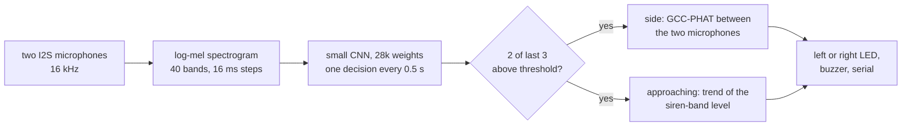

# Awaaz आवाज़

Awaaz ("sound") listens for emergency sirens and tells the driver which side one is coming from. It runs on a ₹500 ESP32-S3 with two microphones, with no camera and no cloud.

**[Try it in your browser](https://23f1000270.github.io/awaaz/)**: it uses the same model and runs entirely on your device.

## Why

In Indian traffic an ambulance can be stuck behind a driver who simply never heard it. Windows are up, the AC and music are on and the street is already full of horns. Riders in helmets have the same problem. Every minute an ambulance loses matters to the patient inside.

A small box that hears the siren, beeps and lights up on the side it is coming from would help the driver clear a path sooner. The parts cost about ₹1,050 and fit any vehicle already on the road.

## How it works



* **Detection.** Each second of sound becomes a log-mel spectrogram, a picture of which pitches are loud over time. A small convolutional network (four convolutional layers and one output layer, 28,000 weights) scores it every half second. An alarm needs two of the last three scores above the threshold, which cuts one-off false alarms.
* **Side.** Sound reaches the nearer microphone a fraction of a millisecond earlier. GCC-PHAT (generalised cross-correlation with phase transform) measures that delay using only the 400 Hz to 4 kHz siren band. The sign of the delay gives left or right. The LED on that side lights up.
* **Approaching or moving away.** The siren-band level is fitted with a line over the last 2.5 seconds or so.
* **Two cores.** On the ESP32-S3 one core reads the microphones and computes features without pause. The other runs the network and the direction code, so no audio is dropped while it thinks. Features come from one microphone, since mixing two microphones 15 cm apart would comb-filter the siren. The firmware builds with ESP-IDF 5.3.1 and uses 71% of the on-chip RAM at build time ([size report](eval/results/firmware_size.txt)).
* **One implementation, three places.** The features and network are written three times: Python for training (`awaaz/`), plain C for the ESP32-S3 (`csrc/`) and JavaScript for the browser (`site/`). The tests feed all three the same inputs and require the same outputs to within 0.0001.

## How well does it work?

### Data

The [Large-scale audio dataset for emergency vehicle sirens and road noises](https://doi.org/10.1038/s41597-022-01727-2) (Asif et al., *Scientific Data*, 2022), released as public domain (CC0). The paper describes 900 clips of each class. The figshare release we downloaded has 932 siren files (folder `Ambulance data`) and 902 road-noise files (folder `Road Noises`), most of them 3 to 15 seconds long.

Neighbouring clips in this dataset seem to be cut from the same source recordings. The average spectra of consecutive clips correlate at 0.87, against 0.63 for random clips of the same class more than 40 clips apart ([split check](eval/results/split_check.md)). So we split by blocks of 40 consecutive clips, never by single clips. Otherwise near-copies of test clips would be in training and the scores would mean little. The decision threshold (0.89) was chosen on the validation split as the lowest at which at most 5% of validation road clips raise an alarm. Nothing was tuned on the test split.

### Results on held-out recordings

Threshold 0.89 chosen on the validation split (5% of validation road clips alarm).

**Held-out recordings** (132 siren clips, 120 road clips, 20 minutes of road noise)

| Measure | Result |
|---|---:|
| Siren clips detected | 87.9% |
| Median time from start of clip to alarm | 1.6 s |
| Road clips with a false alarm | 0.0% |
| False alarms per hour of road noise | 0.0 |
| Window-level ROC AUC | 0.994 |

**Sirens mixed into other road noise** (detection rate)

| Signal-to-noise | Open air | Inside a closed car (simulated) |
|---|---:|---:|
| -10 dB | 30% | 34% |
| -5 dB | 63% | 64% |
| +0 dB | 89% | 83% |
| +5 dB | 92% | 92% |
| +10 dB | 92% | 92% |

**Synthetic Indian siren patterns, never seen in training** (40 clips each)

| Pattern | 0 dB | +10 dB |
|---|---:|---:|
| wail | 100% | 100% |
| yelp | 100% | 100% |
| hilo | 88% | 98% |

**Horns** (synthetic two-tone horn bursts over road noise, 120 clips of 8 s): 0% of clips raise a false alarm.

### Direction, in simulation

Simulated: a siren from the test split passes 3 to 8 m to one side at 8 to 20 m/s, starting behind. Signal-to-noise is measured when the siren is closest. Side accuracy counts only moments when the siren is at least 20 degrees off the line of travel. Approach accuracy counts moments when the distance changed by more than 15 m over the last 3 s.

| Microphone spacing | Signal-to-noise | Side correct | Approach or moving away correct |
|---|---:|---:|---:|
| 15 cm | +0 dB | 89% | 74% |
| 15 cm | +10 dB | 98% | 87% |
| 20 cm | +0 dB | 91% | 72% |
| 20 cm | +10 dB | 91% | 84% |

The device uses 64 ms of audio from each microphone for the side and 128 ms for each level reading, the same as this simulation.

### What these numbers do not cover

* **No road test yet.** These are recordings and simulations. The test plan for the hardware is in [docs/hardware.md](docs/hardware.md).
* **Little road noise.** The test split holds only 20 minutes of road noise. No false alarms in that time does not mean none per hour on a real road.
* **Horns.** The horn test uses the same synthetic horn generator as training. It shows the model learned to reject those horns, not every horn in India. Real horn recordings are the most important missing test.
* **The car cabin is a filter, not a car.** "Inside a closed car" means the sound is low-pass filtered and made 10 to 25 dB quieter. A real cabin also adds reflections, which matter most for direction.
* **Not every siren pattern.** Detection of the synthetic hi-lo pattern is lowest (88% at 0 dB). Indian ambulances use several patterns. More real recordings are needed.

## Use it

Browser: open the [demo](https://23f1000270.github.io/awaaz/) and play an ambulance video on your phone nearby.

Hardware: the parts list, wiring and test plan are in [docs/hardware.md](docs/hardware.md).

```bash
cd firmware
idf.py set-target esp32s3
idf.py -p PORT flash monitor
```

Reproduce the model and the numbers:

```bash
pip install -e ".[train,dev]"
python train/prepare.py --src path/to/dataset --out data/clips.npz
python train/train.py --data data/clips.npz --out awaaz/weights.npz
python eval/evaluate.py --data data/clips.npz
python eval/direction.py --data data/clips.npz
python eval/split_check.py --data data/clips.npz
python train/export.py          # C header for the firmware, JSON for the browser
make test                       # Python, C and JavaScript agree
```

## Licence

Apache-2.0 for the code and the trained weights. The training data is CC0.
